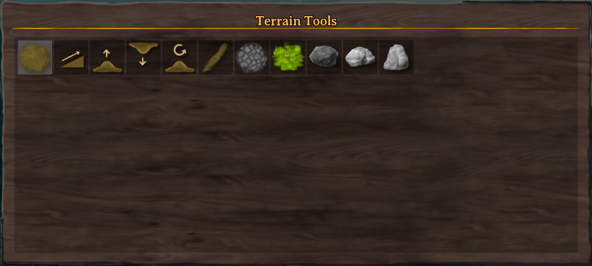
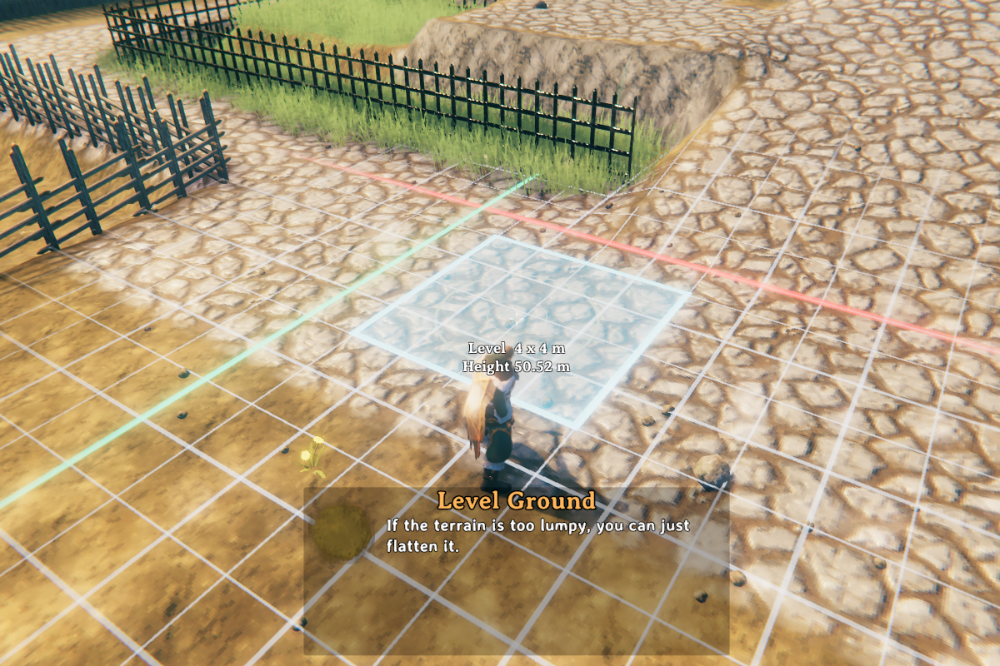
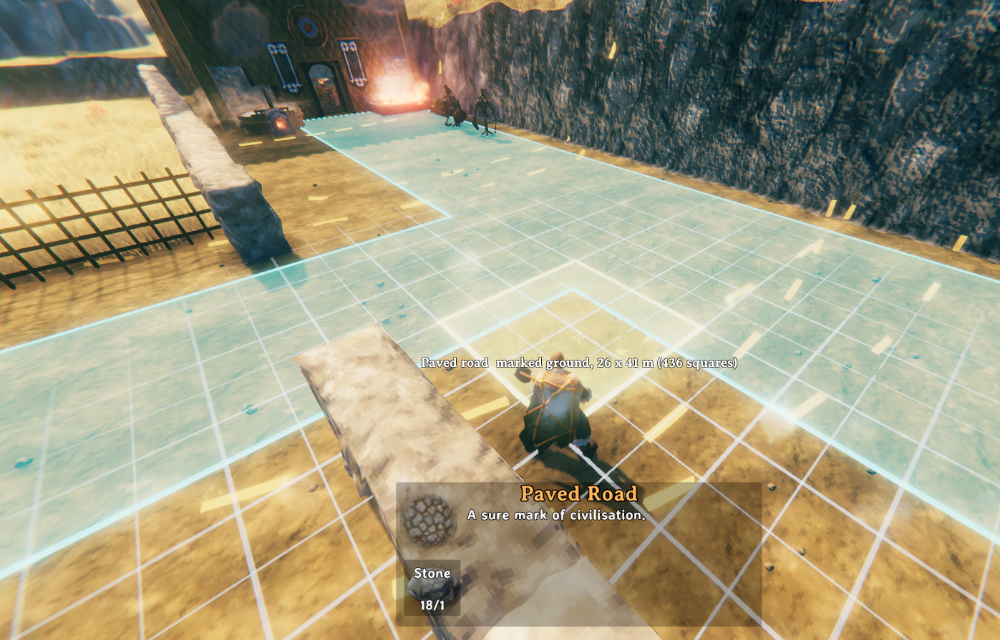
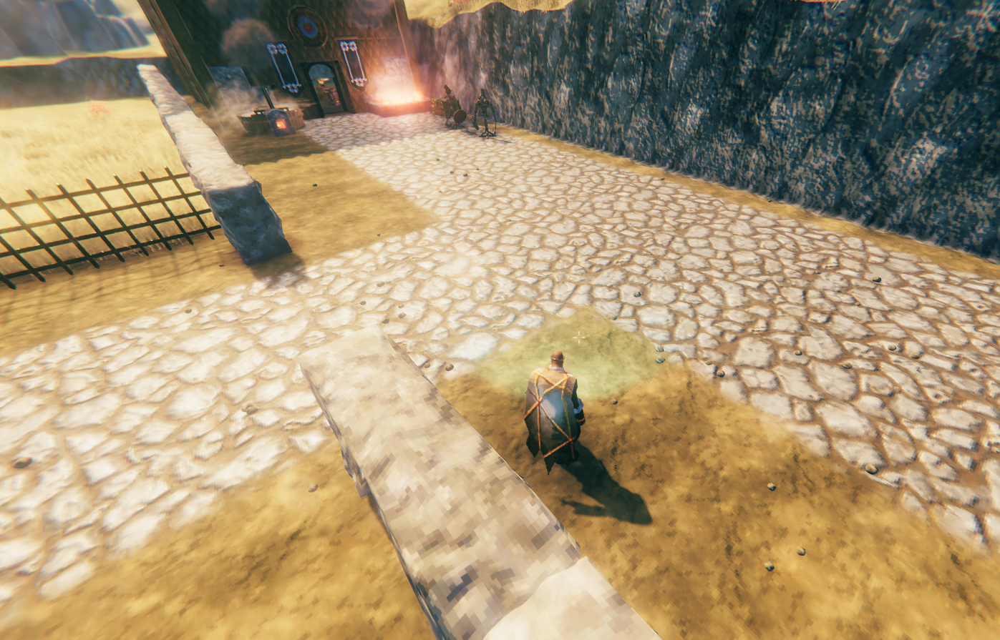
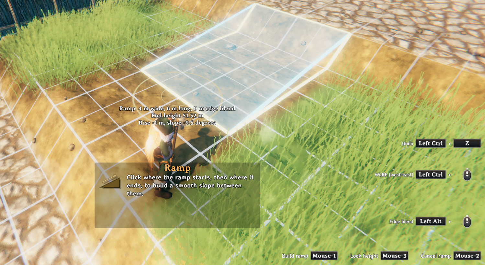
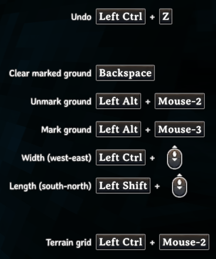

# BetterHoe

Shape terrain on a grid with the hoe: level, raise, lower, paint and reset exact areas, build smooth ramps, and take out a hoe with one key.

- **Equip a hoe**: Press `N` to take out a hoe without having one in your inventory, and again to put it away.
- **Terrain grid**: A grid is drawn on the ground at the terrain's 1 m spacing, matching [BetterHammer](https://thunderstore.io/c/valheim/p/Aestelwen/BetterHammer/)'s build grid.
- **Level ground**: Flatten the whole area to the height you aim at, or lock a height to level several areas to the same height.
- **Ramp**: Click a start and an end to build a smooth, constant slope between them, with sides that blend into the ground.
- **Raise and lower ground**: Lift or sink the whole area by a fixed step. Lower ground is a new hoe tool.
- **Reset height**: A new hoe tool that undoes every height change in the area, back to the natural ground.
- **Paint**: Pathen, Paved road and the new Cultivate and Reset paint tools paint exactly the area. Cultivate prepares the ground for planting without changing its height, and Reset paint removes paths, paving and cultivated ground so the grass grows back.
- **Costs**: Shaping the ground is free and painting costs what vanilla charges, with no workbench or stonecutter needed.
- **Mark ground**: Draw out any shape on the grid with `Alt+Middle-Click`, then level, raise, paint or reset all of it in one click.
- **Preview**: See the area's outline and the surface it will have before you click, with its size and height under the crosshair.
- **Undo and redo**: Undo terrain changes with `Ctrl+Z` and redo them with `Ctrl+Y`.

## Terrain Grid

While one of the hoe's terrain tools is selected, the area it changes is outlined in gold on the ground.
Level, Raise and Lower ground and Reset height also show the new surface in blue.
Like vanilla, ground can't be moved more than 8 m above or below its natural height.

With the grid off, Level ground, Raise ground, Pathen and Paved road work like vanilla. Ramp, Lower ground, Reset height, Cultivate and Reset paint always use the grid.

| Key                | Action                                                        |
| ------------------ | ------------------------------------------------------------- |
| `Ctrl+Scroll`      | Change the area's width (west to east).                       |
| `Shift+Scroll`     | Change the area's length (south to north).                    |
| `Alt+Scroll`       | Change how far Raise and Lower ground move the ground.        |
| `Middle-Click`     | Level ground: lock or unlock the height you are aiming at.    |
| `Ctrl+Right-Click` | Turn the grid on or off for the vanilla tools.                |

## Marking Ground

Mark out the ground you want to change, then use a tool on all of it at once.
The area under the crosshair is the brush: hold `Alt+Middle-Click` and sweep it over the ground to mark it, outlined in teal.
While ground is marked, every tool except Ramp previews its result over all of it, and one click changes all of it.

| Key                | Action                                                                            |
| ------------------ | --------------------------------------------------------------------------------- |
| `Alt+Middle-Click` | Mark the area under the crosshair. Hold to sweep, even while running.             |
| `Alt+Right-Click`  | Unmark the area under the crosshair. Hold to sweep.                               |
| `Backspace`        | Clear all marked ground. With nothing marked, mark the last cleared ground again. |
| `Left-Click`       | Use the selected tool on all marked ground.                                       |

## Ramp

Select **Ramp** in the hoe menu, click where the ramp starts, then click where it ends. Until the second click, a preview shows the ramp's surface in blue, its outline on the ground in gold, and the edge blend in violet, fading out towards the ground. The text under the crosshair shows the ramp's length, end height, rise and slope.

| Key             | Action                                                              |
| --------------- | ------------------------------------------------------------------- |
| `Left-Click`    | Set the start, then build the ramp to the point you're aiming at.   |
| `Right-Click`   | Cancel the start.                                                   |
| `Ctrl+Scroll`   | Change the ramp's width.                                            |
| `Alt+Scroll`    | Change how far the sides blend into the ground around the ramp.     |
| `Middle-Click`  | Lock or unlock the height you are aiming at. Each end uses the lock if it's on when you click. |

## Undo and Redo

| Key      | Action                                   |
| -------- | ---------------------------------------- |
| `Ctrl+Z` | Undo the last terrain change.            |
| `Ctrl+Y` | Redo the last terrain change you undid.  |

- This covers every change made on the grid: levelling, raising, lowering, resetting, painting and ramps. Changes made with the grid off use vanilla's brush and can't be undone.
- Undoing puts the ground back exactly as it was, and redoing puts the change back exactly. Neither costs anything, and materials aren't refunded.
- If the ground is too far away to be loaded, or is now behind someone else's ward, nothing happens.
- The history holds 50 changes by default and lasts until you log out. Making a new change clears what you could redo.

## Keyhints

The mod adds on-screen keyhints with all the listed keybinds.

## Configuration

Settings are in the BepInEx config file `javidahmed64592.betterhoe.cfg`.
Settings marked "(Synced with server)" use the server's values.
Each keybind has a key and a `Modifier` (`None`, `Shift`, `Ctrl` or `Alt`), both picked from a list, so combos like Shift + B can be bound.
`DisabledFeatures` under `[Debug]` is for testing: it turns parts of the mod off by name. Leave it empty to play normally.

## Compatibility

- Every player and the server need the mod, because the terrain changes are sent to whoever looks after that piece of ground.
- Mods that change the hoe's tools or how terrain is edited may clash with the grid.
- Works alongside [BetterHammer](https://thunderstore.io/c/valheim/p/Aestelwen/BetterHammer/): `B` takes out its hammer and `N` this mod's hoe.
- If a game update breaks part of the mod, that part turns off on its own and the log says which one; the rest keeps working.
- This mod has not been tested with a gamepad, only with keyboard and mouse.

## Uninstalling

The terrain changes are ordinary vanilla terrain data, so they stay in the world after the mod is removed. Ramp, Lower ground, Reset height, Cultivate and Reset paint disappear from the hoe, and Raise ground and Paved road need their vanilla materials and stations again.

## License

This project is licensed under the MIT License - see the [LICENSE](https://github.com/javidahmed64592/Valheim-BetterHoe/blob/main/LICENSE) file for details.
